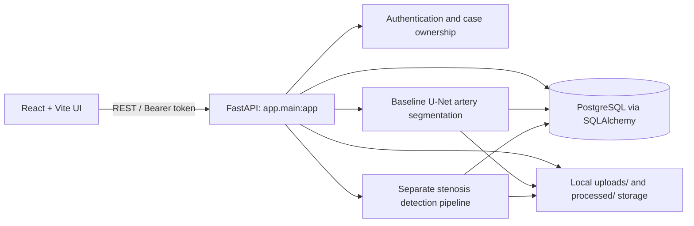

# Artery Segmentation and Stenosis Detection

## Purpose

This repository contains a research web application for managing artery-imaging
patients and cases, uploading scans, running two distinct image-analysis
pipelines, and reviewing saved results. It is not a clinically validated
diagnostic system; model outputs and image-based measurements require qualified
review.

## Architecture at a glance



The database-integrated application is **`app.main:app`**. The React client is
in [`frontend/`](./frontend/). Uploaded images and generated artifacts are
stored on the local filesystem; PostgreSQL stores record metadata and paths to
those files.

### Main code areas

| Area | Responsibility |
| --- | --- |
| [`app/main.py`](./app/main.py), [`app/routers/`](./app/routers/) | Authenticated API, patient/case/image operations, analysis, result retrieval |
| [`app/models.py`](./app/models.py), [`app/database.py`](./app/database.py) | SQLAlchemy entities, PostgreSQL connection and sessions |
| [`app/core/`](./app/core/) | Token/password security and record permissions |
| [`app/baseline_segmentation.py`](./app/baseline_segmentation.py) | Baseline U-Net checkpoint loading, preprocessing, inference and artifact rendering |
| [`app/stenosis_inference.py`](./app/stenosis_inference.py), [`app/stenosis_measurement.py`](./app/stenosis_measurement.py) | Independent stenosis-mask inference and experimental pixel-based measurements |
| [`segmentation/src/`](./segmentation/src/) | U-Net architecture, dataset loader and training scripts |
| [`stenosis_detection/`](./stenosis_detection/) | Multi-scale stenosis model, data loader, training/inference code and checkpoint |
| [`frontend/src/`](./frontend/src/) | Login, protected navigation, patient/case screens and analysis views |
| [`backend/`](./backend/) | Separate, experimental/stateless image-processing API; not the database-backed app |
| [`tests/`](./tests/) | Backend, model, API and dataset/training-related tests |
| [`scripts/init_db.py`](./scripts/init_db.py) | Create missing database tables from registered SQLAlchemy models |

## User and case workflow

1. A user registers or signs in. Registration creates a `medical_researcher`
   account; login returns a bearer token.
2. The UI sends that token with API requests. A `401` response clears the
   browser's saved session and returns the user to login.
3. The user creates a patient and an imaging case, then uploads an image to that
   case.
4. The user chooses either segmentation or stenosis analysis. The pipelines are
   separate; running one does not imply or trigger the other.
5. Analysis runs and output-file references are persisted. The UI retrieves
   prior runs and authorized artifacts through the case/run APIs.

The standard UI routes are `/login`, `/overview`, `/cases`, `/segmentation`,
`/stenosis`, `/model-analytics`, and `/reports`.

### Authentication and ownership

Patient, case, image, analysis-run, report, and artifact endpoints require
authentication. Regular users can access records they created; administrators
can access all records. Access to an image or saved output is checked through
its associated case. The API implements these checks in
[`app/core/permissions.py`](./app/core/permissions.py).

## Analysis pipelines

### Baseline U-Net artery segmentation

The integrated artery segmentation pipeline uses only
[`app/checkpoints/segmentation/unet_baseline_round2_best.pth`](./app/checkpoints/segmentation/unet_baseline_round2_best.pth).
It is loaded into the Baseline U-Net implementation in
[`segmentation/src/unet.py`](./segmentation/src/unet.py) with strict
state-dictionary loading. The checkpoint metadata identifies epoch 11,
validation Dice approximately 0.5208, and 118 state-dictionary entries. The
validation Dice is checkpoint-level evaluation metadata, **not** a Dice score
calculated for an individual uploaded image.

Inference accepts PNG, JPEG, and single-frame grayscale DICOM uploads. RGB
images are converted to three channels; DICOM intensity values are normalized
and replicated across RGB channels. Pixel values are scaled to `[0, 1]`, the
image is padded to dimensions divisible by 16 for the U-Net, and the output is
cropped back to the original dimensions. A sigmoid probability map is
thresholded at `0.5` to produce the binary mask.

The UI uploads an image with `POST /images`, then runs
`POST /images/{image_id}/segment`. The run and its model version are recorded
using the existing database tables. PNG artifacts include the input preview,
binary artery mask, probability map, and overlay. No per-image Dice/IoU is
reported because an uploaded patient image has no corresponding ground-truth
mask in this workflow.

### Stenosis detection

Stenosis detection uses a separate `MultiScaleResidualUNet` and its own
checkpoint at
[`stenosis_detection/checkpoints/resunet_multiscale_frozen_finetuned_best.pt`](./stenosis_detection/checkpoints/resunet_multiscale_frozen_finetuned_best.pt).
It does not load or replace the Baseline U-Net checkpoint.

This pipeline first preprocesses an uploaded image as grayscale and saves a
normalized array. Its inference currently requires a `512 x 512` image with
values in `[0, 1]`, applies a probability threshold of `0.90`, and extracts
connected-component regions. It saves a stenosis mask, probability
visualization, and localization overlay. A subsequent image-intensity-profile
routine estimates widths and narrowing in pixels when the input permits; these
measurements are experimental and not clinically validated.

The UI calls `POST /images/{image_id}/preprocess` followed by
`POST /images/{image_id}/predict`. This route persists the stenosis findings
and artifacts separately from Baseline U-Net segmentation runs. Stenosis
measurements are not inferred from the artery segmentation output.

### Separate experimental API

[`backend/main.py`](./backend/main.py) exposes a different, stateless
prototype API, including `/analyze-scan`, `/upload-image`,
`/extract-centerline`, and `/analyze-vessel-width`. It is not mounted by
`app.main:app`, does not use the authenticated case/result persistence workflow,
and should not be treated as the integrated model API. In particular, its
`model_type` selection changes classical Frangi-filter processing parameters;
it does not load either integrated PyTorch checkpoint. Its centerline and width
routes operate on a supplied mask and are not part of the authenticated
segmentation workflow.

## Database and file storage

The main entities defined in [`app/models.py`](./app/models.py) are:

| Entity | Purpose and relationships |
| --- | --- |
| `User` | Account, role and creator identity |
| `Patient` | Patient record owned by its creator |
| `ImagingCase` | Case linked to a patient and creator |
| `Image` | Uploaded file metadata linked to a case and uploader |
| `ModelVersion` | Model/version metadata, checkpoint path and evaluation metadata |
| `AnalysisRun` | Run status, case, optional image/model version and initiating user |
| `Segment` | Segmentation output metadata linked to a run |
| `StenosisFinding` | Stenosis location, measurements and severity linked to a run |
| `Artifact` | Output type and local storage path linked to a run/image |
| `Report` | Saved report summary linked to a case and optionally a run |
| `Alert`, `AuditLog` | Additional alert and audit-record entities |

Core relationships are: user → patients/cases; patient → cases; case → images,
analysis runs and reports; analysis run → model version, segments, findings and
artifacts. Both model pipelines reuse the existing `analysis_runs` and
`artifacts` tables; the segmentation integration did not require a schema
migration.

Files are stored locally under `uploads/`, `processed/`, and
`processed/predictions/`. Database rows retain relative paths and metadata.
These paths assume a single host or shared filesystem; a multi-instance
deployment would need shared/object storage and coordinated configuration.

[`app/models_milestone2_3.py`](./app/models_milestone2_3.py) defines additional
`ml_`-prefixed entities for broader analysis workflows. The current integrated
routes use the core entities in `app/models.py`; the extra models are registered
by the database initialization script but are not the persistence path for the
two current analysis workflows.

## API reference

FastAPI's interactive API documentation is available at `/docs` when the API
is running.

| Area | Routes |
| --- | --- |
| Health | `GET /`, `GET /health` |
| Authentication | `POST /auth/register`, `POST /auth/login`, `GET /auth/me` |
| Patients | `POST /patients`, `GET /patients`, `GET /patients/{patient_id}`, `PATCH /patients/{patient_id}` |
| Cases | `POST /cases`, `GET /cases`, `GET /cases/{case_id}`, `GET /patients/{patient_id}/cases` |
| Images | `POST /images`, `GET /images?case_id={id}`, `GET /images/{image_id}`, `GET /images/{image_id}/content` |
| Image analysis | `POST /images/{image_id}/segment`, `POST /images/{image_id}/preprocess`, `POST /images/{image_id}/predict` |
| Saved results | `GET /cases/{case_id}/analysis-runs`, `GET /analysis-runs/{analysis_run_id}` |
| Artifacts/reports | `GET /analysis-runs/{analysis_run_id}/artifacts/{artifact_type}`, `GET /reports/{report_id}/download` |

Image uploads use multipart form fields `file` and `case_id`; supported file
extensions are PNG, JPEG and DICOM, with a 20 MB size limit. Artifact and report
retrieval also checks the run's case ownership.

## Local setup

Prerequisites: Python with the packages in [`requirements.txt`](./requirements.txt),
Node.js/npm, and PostgreSQL.

1. From the repository root, create and activate a virtual environment and
   install backend dependencies:

   ```powershell
   py -m venv .venv
   .\.venv\Scripts\Activate.ps1
   python -m pip install -r requirements.txt
   ```

2. Copy `.env.example` to `.env`. Set `DATABASE_URL` to the local PostgreSQL
   database and set `JWT_SECRET_KEY` to a unique random value. Do not commit
   `.env`.
3. Initialize missing tables from the repository root:

   ```powershell
   python -m scripts.init_db
   ```

   The application does not create tables at startup. The script uses
   SQLAlchemy `create_all()` to create missing tables; it is not a migration
   tool and does not alter existing tables. Back up and inspect the target
   database first.
4. Start the integrated API:

   ```powershell
   uvicorn app.main:app --reload
   ```

5. In another terminal, install frontend dependencies and start Vite:

   ```powershell
   Set-Location frontend
   npm install
   npm run dev
   ```

The frontend uses `VITE_API_BASE_URL` when configured; otherwise it targets
`http://127.0.0.1:8000`. FastAPI's development CORS configuration allows the
Vite origins on port 5173.

## Training and evaluation code

The Baseline U-Net architecture and training scripts live under
[`segmentation/src/`](./segmentation/src/); the stenosis model and training
code live under [`stenosis_detection/`](./stenosis_detection/). Training
scripts require their dataset and starting checkpoints. Dataset locations are
configured in the respective loader code and may need to be changed for a
different machine. The integrated application loads the selected checkpoints;
it does not train or fine-tune models at runtime.

## Tests and build

The repository includes focused Baseline U-Net inference/API tests and stenosis
integration tests in `tests/`. Run the relevant backend tests from the
repository root, for example:

```powershell
python -m unittest discover -s tests -p "test_baseline_segmentation*.py" -v
python -m unittest discover -s tests -p "test_stenosis_model_integration.py" -v
```

The frontend checks are:

```powershell
Set-Location frontend
npm run lint
npm run build
```

Dataset/training tests may require local dataset files. Use the focused tests
for model/API changes and provide any required test data before running
dataset-dependent tests.

## Current boundaries and limitations

- Both integrated model outputs are research outputs, not diagnoses.
- Baseline U-Net's validation Dice is an evaluation result for the checkpoint;
  it is not an image-specific result metric.
- The integrated stenosis pipeline requires `512 x 512` grayscale-normalized
  input; Baseline U-Net preserves the uploaded image dimensions.
- Centerline extraction is present only in the separate prototype API; it is
  not part of the authenticated case workflow.
- The integrated UI does not provide Grad-CAM explanations. The prototype's
  heatmap is derived from classical image-processing responses, not gradient
  attribution from either integrated PyTorch model.
- The integrated file storage is local, and the additional `ml_`-prefixed
  schema is not used by the current analysis routes.
